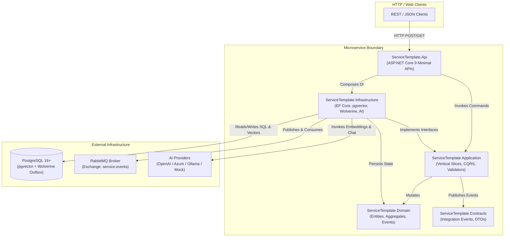
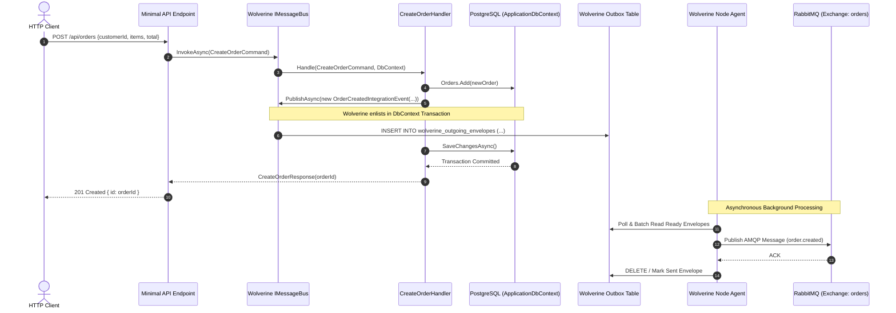
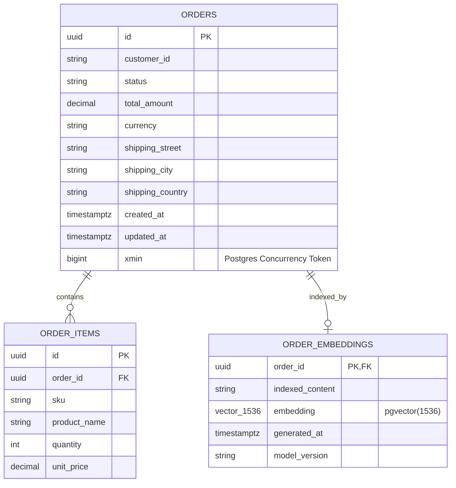
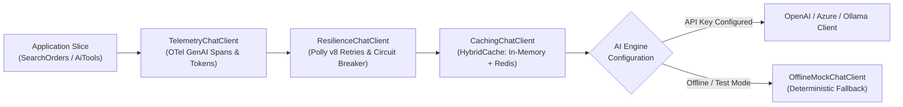
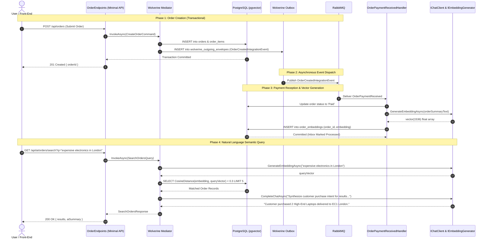

# Technical Architecture & System Design Specification
## Enterprise Microservice Chassis Template (.NET 9 / C# 13)

- **Document Version:** 1.0.0
- **Status:** Approved / Authoritative
- **Author:** Chief Technology Officer (CTO)
- **Target Platform:** .NET 9.0 LTS (C# 13), Ubuntu Linux (x64 / arm64), Docker / Podman, Kubernetes
- **Distribution Model:** `dotnet new` template (`dotnet new microservice-chassis -n <ServiceName>`)

---

## 1. Executive Summary & Architectural Vision

Modern enterprise microservices suffer from the **"blank canvas" anti-pattern**: developers waste days reinventing distributed transactions, outbox patterns, message brokers, resilience policies, telemetry instrumentation, and AI integration pipelines. Conversely, heavy traditional frameworks introduce monolithic coupling, obsolete dependencies, and excessive boilerplate.

This **Enterprise Microservice Chassis Template** establishes a standardized, cloud-native, and production-ready foundation designed to accelerate new service creation from days to seconds. It synthesizes four core paradigms into a unified, zero-debt architecture:

1. **Vertical Slice Architecture within Clean Project Boundaries:** Commands, queries, events, and validators are organized by cohesive business capability (slice), while maintaining strict compile-time dependency isolation via dedicated project assemblies.
2. **Guaranteed At-Least-Once Delivery via Transactional Outbox/Inbox:** Powered by **Wolverine**, combining in-process CQRS mediation with distributed RabbitMQ messaging and native PostgreSQL transactional outbox/inbox guarantees.
3. **Co-located Relational Data & Semantic Search (pgvector):** Leveraging PostgreSQL and **pgvector** within Entity Framework Core, storing structured business records and high-dimensional vector embeddings within the same database engine—eliminating the operational complexity and eventual consistency lag of separate vector databases.
4. **Standardized AI Primitives with Offline Fallback:** Native adoption of **`Microsoft.Extensions.AI`** (`IChatClient`, `IEmbeddingGenerator`) and **Semantic Kernel** plugin models, engineered with a resilient decorator pipeline (telemetry, caching, circuit breakers) and an offline mock provider for zero-dependency local execution and deterministic automated testing.

```
+---------------------------------------------------------------------------------------------------+
|                                      Enterprise Microservice Chassis                              |
|                                                                                                   |
|  +---------------------------------------------------------------------------------------------+  |
|  |                                  ServiceTemplate.Api (Host)                                 |  |
|  |   - Minimal APIs        - Scalar / OpenAPI      - OpenTelemetry      - Health Checks        |  |
|  +----------------------------------------------+----------------------------------------------+  |
|                                                 |                                                 |
|  +----------------------------------------------v----------------------------------------------+  |
|  |                               ServiceTemplate.Application                                  |  |
|  |  +--------------------------+  +--------------------------+  +---------------------------+  |  |
|  |  | CreateOrder Slice        |  | ProcessPayment Slice     |  | SemanticSearch Slice      |  |  |
|  |  | - Command & Validator    |  | - Message Consumer       |  | - Query & Vector Search   |  |  |
|  |  | - Wolverine Handler      |  | - Idempotency Logic      |  | - Semantic Kernel Tools   |  |  |
|  |  +--------------------------+  +--------------------------+  +---------------------------+  |  |
|  +----------------------------------------------+----------------------------------------------+  |
|                                                 |                                                 |
|  +----------------------------------------------v----------------------------------------------+  |
|  |                                  ServiceTemplate.Domain                                     |  |
|  |   - Order Aggregate     - Domain Events        - Value Objects      - Business Invariants   |  |
|  +----------------------------------------------^----------------------------------------------+  |
|                                                 |                                                 |
|  +----------------------------------------------+----------------------------------------------+  |
|  |                               ServiceTemplate.Infrastructure                                |  |
|  |  +--------------------------+  +--------------------------+  +---------------------------+  |  |
|  |  | PostgreSQL + pgvector    |  | Wolverine Message Broker |  | Resilient AI Client Chain |  |  |
|  |  | - EF Core DbContext      |  | - Outbox / Inbox Engine  |  | - IChatClient Decorators  |  |  |
|  |  | - HNSW Vector Indices    |  | - RabbitMQ Transport     |  | - Offline Mock AI Fallback|  |  |
|  |  +--------------------------+  +--------------------------+  +---------------------------+  |  |
|  +---------------------------------------------------------------------------------------------+  |
|                                                 |                                                 |
|  +----------------------------------------------v----------------------------------------------+  |
|  |                                  ServiceTemplate.Contracts                                  |  |
|  |   - Public Integration Events (e.g., OrderCreatedIntegrationEvent)   - Shared Public DTOs   |  |
|  +---------------------------------------------------------------------------------------------+  |
+---------------------------------------------------------------------------------------------------+
```

---

## 2. Architectural Principles & Invariants

### 2.1 Core Architectural Principles

1. **Independent Deployability & Explicit Boundaries:** Each microservice created from this template owns its private schema, domain rules, and communication contracts. Cross-service database joins are strictly prohibited.
2. **Pragmatic Vertical Slices:** Code that changes together stays together. A feature slice (e.g., `CreateOrder`) houses its command, validator, response DTO, and handler in a single folder. We reject artificial layered horizontal fragmentation (such as placing a single feature's logic across 5 separate repositories or disparate cross-project folders).
3. **Transactionally Bound Messaging (Outbox Pattern):** A state transition and its corresponding integration event MUST commit in the same local database transaction. Messages are never published directly over the wire inside the HTTP request cycle; they are committed to the outbox table and delivered asynchronously by Wolverine.
4. **Idempotency by Design (Inbox Pattern):** Message consumers MUST tolerate at-least-once message delivery. Wolverine's native PostgreSQL inbox tracking deduplicates incoming messages using unique message identifiers before handler execution.
5. **Zero-Dependency Local Onboarding:** The chassis must start and pass all tests out-of-the-box without requiring live cloud AI credentials or active external cloud subscriptions. An offline deterministic AI provider simulates embeddings and chat reasoning when remote endpoints are unconfigured.
6. **Machine-Enforced Architecture Guardrails:** Architectural integrity is not maintained through wikis; it is enforced programmatically via **ArchUnitNET** unit tests executed on every CI build.

### 2.2 System Invariants Matrix

| Boundary Invariant | Rule | Enforcement Mechanism |
| :--- | :--- | :--- |
| **Domain Isolation** | `ServiceTemplate.Domain` must not reference any other project or third-party infrastructure NuGet packages (pure C#). | ArchUnitNET test `Domain_Should_Not_Depend_On_Other_Projects` |
| **Application Layering** | `ServiceTemplate.Application` may reference `Domain` and `Contracts`, but MUST NOT reference `Infrastructure` or `Api`. | ArchUnitNET test `Application_Should_Not_Depend_On_Infrastructure_Or_Api` |
| **Contracts Purity** | `ServiceTemplate.Contracts` must have zero internal project references and zero infrastructure dependencies. | ArchUnitNET test `Contracts_Should_Be_Self_Contained` |
| **Database Access** | Domain entities and `DbContext` must never be exposed directly in API route signatures or returned to HTTP clients. | Compiler & Code Review + ArchUnitNET |
| **Outbox Commitment** | Integration events published to Wolverine's `IMessageBus` within an EF Core transaction must use Wolverine's transactional outbox context. | Wolverine EF Core Middleware |

---

## 3. Solution Structure & Directory Layout

### 3.1 Physical Filesystem Layout

```
ServiceTemplate/
├── .template.config/
│   └── template.json                      # dotnet new template configuration & replacement tokens
├── .github/
│   └── workflows/
│       ├── build-and-test.yml             # Linux CI pipeline (dotnet test, arch tests, docker build)
│       └── release-template.yml           # Pack & push NuGet template package
├── docker/
│   ├── docker-compose.yml                 # Local infra: PostgreSQL (pgvector enabled) & RabbitMQ
│   ├── Dockerfile                         # Production multi-stage chiseled Ubuntu .NET 9 container
│   └── init-db.sql                        # Extension bootstrap: CREATE EXTENSION IF NOT EXISTS vector;
├── src/
│   ├── ServiceTemplate.Contracts/         # Public contracts, integration events, shared DTOs
│   │   ├── Events/
│   │   │   └── OrderCreatedIntegrationEvent.cs
│   │   ├── Common/
│   │   │   └── IntegrationEvent.cs
│   │   └── ServiceTemplate.Contracts.csproj
│   │
│   ├── ServiceTemplate.Domain/            # Pure enterprise business logic & domain model
│   │   ├── Common/
│   │   │   ├── AggregateRoot.cs
│   │   │   ├── Entity.cs
│   │   │   ├── ValueObject.cs
│   │   │   └── IDomainEvent.cs
│   │   ├── Orders/
│   │   │   ├── Order.cs                   # Aggregate Root
│   │   │   ├── OrderItem.cs
│   │   │   ├── OrderStatus.cs
│   │   │   ├── ValueObjects/
│   │   │   │   ├── Address.cs
│   │   │   │   └── Money.cs
│   │   │   └── Events/
│   │   │       └── OrderSubmittedDomainEvent.cs
│   │   ├── Exceptions/
│   │   │   ├── DomainException.cs
│   │   │   └── OrderNotFoundException.cs
│   │   └── ServiceTemplate.Domain.csproj
│   │
│   ├── ServiceTemplate.Application/       # Vertical slices (Commands, Queries, Handlers, AI Tools)
│   │   ├── Common/
│   │   │   ├── Behaviours/
│   │   │   │   └── ValidationMiddleware.cs
│   │   │   ├── Exceptions/
│   │   │   │   └── ValidationException.cs
│   │   │   └── Interfaces/
│   │   │       ├── IApplicationDbContext.cs
│   │   │       └── ISemanticSearchService.cs
│   │   ├── Orders/
│   │   │   ├── CreateOrder/
│   │   │   │   ├── CreateOrderCommand.cs
│   │   │   │   ├── CreateOrderValidator.cs
│   │   │   │   ├── CreateOrderResponse.cs
│   │   │   │   └── CreateOrderHandler.cs  # Wolverine message handler
│   │   │   ├── ProcessPayment/
│   │   │   │   ├── OrderPaymentReceived.cs
│   │   │   │   └── OrderPaymentReceivedHandler.cs
│   │   │   └── SearchOrders/
│   │   │       ├── SearchOrdersQuery.cs
│   │   │       ├── SearchOrdersResponse.cs
│   │   │       └── SearchOrdersHandler.cs
│   │   ├── AiTools/
│   │   │   ├── OrderInventoryPlugin.cs    # Semantic Kernel tool for chat agents
│   │   │   └── OrderSummaryPlugin.cs
│   │   └── ServiceTemplate.Application.csproj
│   │
│   ├── ServiceTemplate.Infrastructure/    # Persistence, Wolverine outbox/inbox, AI clients, OTel
│   │   ├── Persistence/
│   │   │   ├── ApplicationDbContext.cs
│   │   │   ├── Configurations/
│   │   │   │   ├── OrderConfiguration.cs
│   │   │   │   └── OrderEmbeddingConfiguration.cs
│   │   │   └── Migrations/
│   │   ├── Messaging/
│   │   │   ├── WolverineConfiguration.cs  # Outbox/Inbox, RabbitMQ routing, error policies
│   │   │   └── Extensions/
│   │   │       └── WolverineOptionsExtensions.cs
│   │   ├── Ai/
│   │   │   ├── Configuration/
│   │   │   │   └── AiOptions.cs
│   │   │   ├── Decorators/
│   │   │   │   ├── ResilientChatClient.cs
│   │   │   │   ├── TelemetryChatClient.cs
│   │   │   │   └── CachingChatClient.cs
│   │   │   ├── Mock/
│   │   │   │   ├── OfflineMockChatClient.cs
│   │   │   │   └── OfflineMockEmbeddingGenerator.cs
│   │   │   ├── SemanticSearchService.cs
│   │   │   └── AiServiceRegistration.cs
│   │   ├── Observability/
│   │   │   └── OpenTelemetryExtensions.cs
│   │   └── ServiceTemplate.Infrastructure.csproj
│   │
│   └── ServiceTemplate.Api/               # ASP.NET Core 9 Host, Minimal API Endpoints, Middleware
│       ├── Endpoints/
│       │   ├── OrderEndpoints.cs          # MapGroup("/api/orders")
│       │   └── AiEndpoints.cs             # MapGroup("/api/ai")
│       ├── Middleware/
│       │   └── GlobalExceptionHandler.cs  # RFC 7807 ProblemDetails
│       ├── appsettings.json
│       ├── appsettings.Development.json
│       ├── Program.cs                     # WebApplication builder with Wolverine & Minimal APIs
│       └── ServiceTemplate.Api.csproj
│
└── tests/
    ├── ServiceTemplate.UnitTests/         # Isolated slice and domain tests
    │   ├── Domain/
    │   │   └── OrderTests.cs
    │   ├── Application/
    │   │   ├── CreateOrderValidatorTests.cs
    │   │   └── CreateOrderHandlerTests.cs
    │   └── ServiceTemplate.UnitTests.csproj
    │
    ├── ServiceTemplate.IntegrationTests/  # Testcontainers integration tests (Postgres + RabbitMQ)
    │   ├── Fixtures/
    │   │   ├── MicroserviceFixture.cs     # Testcontainers lifecycle management
    │   │   └── DatabaseFixture.cs
    │   ├── Slices/
    │   │   ├── CreateOrderIntegrationTests.cs
    │   │   └── SemanticSearchIntegrationTests.cs
    │   └── ServiceTemplate.IntegrationTests.csproj
    │
    └── ServiceTemplate.ArchitectureTests/ # ArchUnitNET automated boundary verification
        ├── BoundaryTests.cs
        ├── CleanArchitectureTests.cs
        └── ServiceTemplate.ArchitectureTests.csproj
```

---

## 4. Bill of Materials (BOM) & Project Dependencies

### 4.1 Dependency Flow Diagram



### 4.2 Exact NuGet Package Specification

All projects target **`net9.0`** with `<Nullable>enable</Nullable>`, `<ImplicitUsings>enable</ImplicitUsings>`, and `<TreatWarningsAsErrors>true</TreatWarningsAsErrors>`.

#### 1. `ServiceTemplate.Contracts.csproj`
- **Project References:** None.
- **Dependencies:** None (Pure C# models for public distribution as a standalone NuGet package if desired).

#### 2. `ServiceTemplate.Domain.csproj`
- **Project References:** None.
- **Dependencies:** None (Zero external dependencies; completely framework-agnostic).

#### 3. `ServiceTemplate.Application.csproj`
- **Project References:**
  - `ServiceTemplate.Domain.csproj`
  - `ServiceTemplate.Contracts.csproj`
- **NuGet Packages:**
  - `WolverineFx` (v3.4.0+) — Core messaging abstractions and in-memory mediation.
  - `FluentValidation` (v11.11.0+) — Strongly-typed validation rules per command/query.
  - `FluentValidation.DependencyInjectionExtensions` (v11.11.0+) — Service registration for validators.
  - `Microsoft.Extensions.AI.Abstractions` (v9.0.1-preview.1.24607.9+) — Unified interfaces (`IChatClient`, `IEmbeddingGenerator`).
  - `Microsoft.SemanticKernel.Core` (v1.33.0+) — Tool definitions, plugins, and kernel abstractions.

#### 4. `ServiceTemplate.Infrastructure.csproj`
- **Project References:**
  - `ServiceTemplate.Application.csproj`
  - `ServiceTemplate.Domain.csproj`
  - `ServiceTemplate.Contracts.csproj`
- **NuGet Packages:**
  - `Npgsql.EntityFrameworkCore.PostgreSQL` (v9.0.2+) — PostgreSQL database provider for EF Core.
  - `Pgvector.EntityFrameworkCore` (v0.2.1+) — EF Core extension for pgvector data types and vector operations.
  - `Microsoft.EntityFrameworkCore.Design` (v9.0.0+) — Migration tooling support.
  - `WolverineFx.EntityFrameworkCore` (v3.4.0+) — EF Core transactional middleware and outbox persistence.
  - `WolverineFx.Postgresql` (v3.4.0+) — Native PostgreSQL outbox/inbox schema and batch storage.
  - `WolverineFx.RabbitMQ` (v3.4.0+) — AMQP 0-9-1 transport integration for Wolverine.
  - `Microsoft.Extensions.AI` (v9.0.1-preview.1.24607.9+) — Microsoft unified AI concrete pipeline components.
  - `Microsoft.Extensions.AI.OpenAI` (v9.0.1-preview.1.24607.9+) — OpenAI / Azure OpenAI / Ollama compatible adapter.
  - `Microsoft.Extensions.Resilience` (v9.0.0+) — Polly v8 integration with standardized retry/circuit-breaker pipelines.
  - `Microsoft.Extensions.Caching.Hybrid` (v9.0.0-preview.9+) — High-performance L1/L2 caching for embeddings and tools.
  - `OpenTelemetry.Extensions.Hosting` (v1.10.0+) — Telemetry host registration.
  - `OpenTelemetry.Instrumentation.AspNetCore` (v1.9.0+) — ASP.NET Core trace/metric capture.
  - `OpenTelemetry.Instrumentation.EntityFrameworkCore` (v1.0.0-beta.12+) — EF Core database query tracing.
  - `OpenTelemetry.Exporter.OpenTelemetryProtocol` (v1.10.0+) — OTLP gRPC/HTTP exporter.

#### 5. `ServiceTemplate.Api.csproj`
- **Project References:**
  - `ServiceTemplate.Application.csproj`
  - `ServiceTemplate.Infrastructure.csproj`
- **NuGet Packages:**
  - `Microsoft.AspNetCore.OpenApi` (v9.0.0+) — Native .NET 9 OpenAPI document generation.
  - `Scalar.AspNetCore` (v2.0.0+) — Modern interactive API documentation client (OpenAPI GUI).
  - `WolverineFx.Http` (v3.4.0+) — Minimal API integration and route binding for Wolverine endpoints.

#### 6. `tests/ServiceTemplate.UnitTests.csproj`
- **Project References:**
  - `ServiceTemplate.Application.csproj`
  - `ServiceTemplate.Domain.csproj`
- **NuGet Packages:**
  - `xunit` (v2.9.2+) & `xunit.runner.visualstudio` (v3.0.0+)
  - `FluentAssertions` (v7.0.0+)
  - `NSubstitute` (v5.3.0+)
  - `Microsoft.NET.Test.Sdk` (v17.12.0+)

#### 7. `tests/ServiceTemplate.IntegrationTests.csproj`
- **Project References:**
  - `ServiceTemplate.Api.csproj`
  - `ServiceTemplate.Infrastructure.csproj`
- **NuGet Packages:**
  - `Microsoft.AspNetCore.Mvc.Testing` (v9.0.0+)
  - `Testcontainers.PostgreSql` (v4.1.0+) — Spins up ephemeral PostgreSQL container with pgvector.
  - `Testcontainers.RabbitMq` (v4.1.0+) — Ephemeral RabbitMQ broker instance.
  - `Alba` (v8.1.0+) — High-speed HTTP scenario testing for ASP.NET Core.

#### 8. `tests/ServiceTemplate.ArchitectureTests.csproj`
- **Project References:**
  - `ServiceTemplate.Domain.csproj`
  - `ServiceTemplate.Application.csproj`
  - `ServiceTemplate.Infrastructure.csproj`
  - `ServiceTemplate.Contracts.csproj`
  - `ServiceTemplate.Api.csproj`
- **NuGet Packages:**
  - `ArchUnitNET.xUnit` (v0.11.1+) — Declarative architecture invariant validation.

---

## 5. Messaging Architecture & Wolverine Operational Policies

### 5.1 Transactional Outbox & Inbox Lifecycle

Wolverine serves as both the **In-Process CQRS Mediator** and the **Distributed Event Gateway**. When an application command runs, it utilizes the PostgreSQL Transactional Outbox pattern to guarantee that local state changes and event dispatches succeed or fail atomically.



### 5.2 Wolverine Configuration & Error Handling Specification

Wolverine must be configured in `ServiceTemplate.Infrastructure/Messaging/WolverineConfiguration.cs` with deterministic retry rules, circuit breaking, and dead-letter queue (DLQ) policies.

```csharp
public static class WolverineConfiguration
{
    public static void ConfigureWolverine(this WolverineOptions opts, IConfiguration configuration)
    {
        // 1. Transactional Outbox/Inbox with EF Core & PostgreSQL
        opts.UseEntityFrameworkCoreTransactions();
        opts.Policies.AutoApplyTransactions();
        opts.PersistMessagesWithPostgresql(
            configuration.GetConnectionString("Database")!,
            schema: "wolverine_messages"
        );

        // 2. Transport Configuration (RabbitMQ)
        var rabbitConfig = configuration.GetSection("RabbitMQ");
        var rabbitHost = rabbitConfig.GetValue<string>("Host") ?? "localhost";
        var rabbitPort = rabbitConfig.GetValue<int>("Port", 5672);
        var rabbitUser = rabbitConfig.GetValue<string>("Username") ?? "guest";
        var rabbitPass = rabbitConfig.GetValue<string>("Password") ?? "guest";

        opts.UseRabbitMq(new Uri($"amqp://{rabbitUser}:{rabbitPass}@{rabbitHost}:{rabbitPort}"))
            .AutoProvision()
            .ConfigureSenders(s => s.UseDurableOutbox());

        // Publish public integration events to RabbitMQ topic exchange
        opts.PublishMessage<OrderCreatedIntegrationEvent>()
            .ToRabbitExchange("orders.topic", exchange =>
            {
                exchange.IsDurable = true;
                exchange.ExchangeType = ExchangeType.Topic;
            })
            .WithRoutingKey("order.created");

        // Listen to incoming payment events via durable queue with Inbox
        opts.ListenToRabbitQueue("orders.payment-received")
            .UseDurableInbox()
            .CircuitBreaker(cb =>
            {
                cb.FailurePercentageThreshold = 30;
                cb.TrackingPeriod = 1.Minutes();
                cb.PauseTime = 30.Seconds();
            });

        // 3. Global Failure & Dead Letter Queue (Poison Message) Policies
        opts.Policies.OnException<NpgsqlException>()
            .RetryWithCooldown(50.Milliseconds(), 200.Milliseconds(), 1.Seconds());

        opts.Policies.OnException<TimeoutException>()
            .RetryWithCooldown(100.Milliseconds(), 500.Milliseconds(), 2.Seconds());

        // Default retry strategy: 3 retries with exponential backoff before sending to DLQ
        opts.Policies.DefaultFailureHandling(rules =>
        {
            rules.RetryWithCooldown(
                100.Milliseconds(),
                500.Milliseconds(),
                2.Seconds()
            );
            rules.MoveToErrorQueue("orders.poison-dlq");
        });

        // 4. In-Process Validation Middleware Pipeline
        opts.Policies.AddMiddleware<ValidationMiddleware>();
    }
}
```

### 5.3 Message Idempotency Guarantees

Every message dispatched through Wolverine carries an envelope containing:
- `Id` (Guid): Globally unique message identifier.
- `CorrelationId`: Trace correlation identifier matching the incoming W3C `traceparent`.
- `Attempts`: Current delivery attempt count.

When consumed with `.UseDurableInbox()`, Wolverine records the message ID in the `wolverine_incoming_envelopes` table inside the database transaction. If an envelope with the same message ID is re-received, it is discarded immediately without executing business logic, preventing duplicate financial or state mutations.

---

## 6. Persistence & Vector Search Architecture (PostgreSQL + pgvector)

### 6.1 Unified Storage Paradigm

Rather than maintaining a separate vector database (e.g., Pinecone, Milvus, Qdrant) that creates distributed sync lag, dual-write failures, and increased operational overhead, this chassis co-locates relational business entities and high-dimensional vector embeddings within **PostgreSQL 16+** using the **pgvector** extension.



### 6.2 EF Core DbContext & pgvector Configuration

The `ApplicationDbContext` registers the vector extension and configures the `OrderEmbedding` entity with an **HNSW (Hierarchical Navigable Small World)** vector index for sub-millisecond approximate nearest neighbor (ANN) search.

```csharp
public class ApplicationDbContext : DbContext, IApplicationDbContext
{
    public DbSet<Order> Orders => Set<Order>();
    public DbSet<OrderItem> OrderItems => Set<OrderItem>();
    public DbSet<OrderEmbedding> OrderEmbeddings => Set<OrderEmbedding>();

    public ApplicationDbContext(DbContextOptions<ApplicationDbContext> options)
        : base(options) { }

    protected override void OnModelCreating(ModelBuilder modelBuilder)
    {
        base.OnModelCreating(modelBuilder);

        // 1. Enable pgvector extension
        modelBuilder.HasPostgresExtension("vector");

        // 2. Order Configuration
        modelBuilder.Entity<Order>(builder =>
        {
            builder.ToTable("orders");
            builder.HasKey(o => o.Id);
            builder.Property(o => o.CustomerId).IsRequired().HasMaxLength(100);
            builder.Property(o => o.Status).HasConversion<string>().HasMaxLength(50);
            
            builder.OwnsOne(o => o.TotalAmount, m =>
            {
                m.Property(p => p.Amount).HasColumnName("total_amount").HasPrecision(18, 4);
                m.Property(p => p.Currency).HasColumnName("currency").HasMaxLength(3);
            });

            builder.OwnsOne(o => o.ShippingAddress, a =>
            {
                a.Property(p => p.Street).HasColumnName("shipping_street").HasMaxLength(200);
                a.Property(p => p.City).HasColumnName("shipping_city").HasMaxLength(100);
                a.Property(p => p.Country).HasColumnName("shipping_country").HasMaxLength(100);
            });

            builder.UseXminAsConcurrencyToken();
            builder.HasMany(o => o.Items).WithOne().HasForeignKey("order_id").OnDelete(DeleteBehavior.Cascade);
        });

        // 3. OrderEmbedding Configuration with HNSW Index
        modelBuilder.Entity<OrderEmbedding>(builder =>
        {
            builder.ToTable("order_embeddings");
            builder.HasKey(e => e.OrderId);
            builder.Property(e => e.IndexedContent).IsRequired();
            builder.Property(e => e.Embedding).HasColumnType("vector(1536)");

            // Configure HNSW Index with Cosine Distance
            builder.HasIndex(e => e.Embedding)
                   .HasMethod("hnsw")
                   .HasOperators("vector_cosine_ops")
                   .HasStorageParameter("m", 16)
                   .HasStorageParameter("ef_construction", 64);
        });
    }
}
```

### 6.3 Semantic Search LINQ Query Pattern

Vector search is executed directly inside EF Core using the `Pgvector.EntityFrameworkCore` extension without writing raw untyped SQL strings:

```csharp
public async Task<IReadOnlyList<OrderSearchResult>> SearchOrdersAsync(
    Vector queryEmbedding, 
    int topK = 5, 
    CancellationToken cancellationToken = default)
{
    // Cosine distance: 0 indicates identical vectors; 2 indicates diametric opposites.
    return await _dbContext.OrderEmbeddings
        .AsNoTracking()
        .OrderBy(e => e.Embedding.CosineDistance(queryEmbedding))
        .Take(topK)
        .Select(e => new OrderSearchResult(
            e.OrderId,
            e.IndexedContent,
            1.0 - e.Embedding.CosineDistance(queryEmbedding) // Semantic similarity score [0.0 - 1.0]
        ))
        .ToListAsync(cancellationToken);
}
```

---

## 7. AI Integration Pipeline & Architecture

### 7.1 Unified AI Abstractions (`Microsoft.Extensions.AI`)

All AI capabilities operate over the standardized interfaces introduced in `Microsoft.Extensions.AI`:
- **`IChatClient`**: Unified model interaction for chat, structured JSON completion, and function/tool calling.
- **`IEmbeddingGenerator<string, Embedding<float>>`**: Standardized text-to-vector embedding generation.

Direct coupling to vendor-specific SDK classes (e.g., `OpenAIClient`, `AnthropicClient`) is strictly prohibited in application slices.

### 7.2 Resilient Decorator Pipeline

To ensure enterprise stability, AI clients are registered through a **Decorator Chain** in `ServiceTemplate.Infrastructure`:



#### Pipeline Responsibilities:
1. **`TelemetryChatClient`**: Intercepts requests to emit OpenTelemetry spans conformant to the **OpenTelemetry Semantic Conventions for Generative AI Systems** (capturing model name, prompt tokens, completion tokens, finish reason, and latency).
2. **`ResilienceChatClient`**: Employs Polly v8 resilience pipelines configured with:
   - **Timeout Policy**: 15-second total execution deadline.
   - **Retry Policy**: 3 retries with jittered exponential backoff on HTTP 429 (Rate Limit) and 503 (Service Unavailable).
   - **Circuit Breaker**: Breaks circuit for 30 seconds if failure rate exceeds 50% over a 1-minute window.
3. **`CachingChatClient`**: Intercepts deterministic queries (e.g., embedding lookups or cached RAG completions) using ASP.NET Core `HybridCache` to prevent redundant billing costs and eliminate external network roundtrips.
4. **`OfflineMockChatClient` & `OfflineMockEmbeddingGenerator`**: Activated when `AiOptions:Provider` is set to `"Mock"` or when no API keys are present. Generates:
   - Consistent, normalized float vectors based on hash-seeded deterministic math.
   - Structured responses simulating intelligent agent outputs for local integration testing.

---

## 8. Reference Domain: Order Management & Semantic Processing

To prove the architectural capabilities without ambiguity, the template implements a production-grade **Order Management** reference domain:

### 8.1 Slices Implementation Specification

```
src/ServiceTemplate.Application/Orders/
├── CreateOrder/
│   ├── CreateOrderCommand.cs          # Record (CustomerId, Items, Address)
│   ├── CreateOrderValidator.cs        # FluentValidation (Items not empty, Quantities > 0)
│   ├── CreateOrderResponse.cs         # Record (OrderId, TotalAmount, Status)
│   └── CreateOrderHandler.cs          # Enlists in Outbox, persists Order, publishes OrderCreatedIntegrationEvent
│
├── ProcessPayment/
│   ├── OrderPaymentReceived.cs        # Integration event consumed from RabbitMQ
│   └── OrderPaymentReceivedHandler.cs # Idempotent handler: transitions status to Paid, generates vector
│
└── SearchOrders/
    ├── SearchOrdersQuery.cs           # Record (NaturalLanguageQuery, TopK)
    ├── SearchOrdersResponse.cs        # Record (List of matched orders with similarity scores & AI synthesis)
    └── SearchOrdersHandler.cs         # Generates query embedding -> executes pgvector query -> synthesizes via IChatClient
```

### 8.2 End-to-End Execution Flow



---

## 9. Security, Operational Readiness & Linux Containerization

### 9.1 Multi-Stage Chiseled Ubuntu Dockerfile

The service packages into a hardened, non-root, minimal attack-surface container image based on **Ubuntu Chiseled Runtimes**:

```dockerfile
# Stage 1: Build & Publish
FROM mcr.microsoft.com/dotnet/sdk:9.0-noble AS build
ARG TARGETARCH
WORKDIR /src

# Copy project files first for optimal layer caching
COPY ["src/*/*.csproj", "./"]
RUN for file in $(ls *.csproj); do mkdir -p ${file%.*} && mv $file ${file%.*}/; done
COPY ["ServiceTemplate.sln", "./"]
RUN dotnet restore ServiceTemplate.sln -a $TARGETARCH

# Copy complete source and build release binary
COPY src/ ./src/
WORKDIR /src/src/ServiceTemplate.Api
RUN dotnet publish -c Release -a $TARGETARCH -o /app/publish \
    --no-restore \
    /p:UseAppHost=false

# Stage 2: Hardened Runtime (Ubuntu Chiseled - Non-Root, No Shell, No Package Manager)
FROM mcr.microsoft.com/dotnet/aspnet:9.0-noble-chiseled AS final
WORKDIR /app
EXPOSE 8080
ENV ASPNETCORE_URLS=http://+:8080 \
    DOTNET_EnableDiagnostics=0 \
    ASPNETCORE_HTTP_PORTS=8080

COPY --from=build /app/publish .
USER $APP_UID
ENTRYPOINT ["dotnet", "ServiceTemplate.Api.dll"]
```

### 9.2 Observability & Health Checks

1. **OpenTelemetry Setup**:
   - Traces exported via OTLP (`OTEL_EXPORTER_OTLP_ENDPOINT`).
   - Standard semantic conventions for ASP.NET Core, EF Core, Wolverine, and GenAI client spans.
2. **Health Endpoints**:
   - `/health/live`: Fast liveness check (responds 200 OK if Kestrel is running).
   - `/health/ready`: Deep readiness check verifying database connectivity, pgvector extension availability, and RabbitMQ broker socket responsiveness.

---

## 10. Automated Architecture Testing (ArchUnitNET Guardrails)

Architectural boundaries are strictly enforced in `tests/ServiceTemplate.ArchitectureTests/BoundaryTests.cs`. A commit violating these rules fails the build immediately:

```csharp
public class BoundaryTests
{
    private static readonly Architecture Architecture =
        new ArchLoader().LoadAssemblies(
            typeof(Order).Assembly,                     // Domain
            typeof(CreateOrderCommand).Assembly,        // Application
            typeof(ApplicationDbContext).Assembly,      // Infrastructure
            typeof(OrderCreatedIntegrationEvent).Assembly, // Contracts
            typeof(Program).Assembly                    // Api
        ).Build();

    [Fact]
    public void Domain_Should_Not_Depend_On_Any_Other_Project()
    {
        Types().That().ResideInAssembly(typeof(Order).Assembly)
            .Should().NotDependOnAny(
                Types().That().ResideInAssembly(typeof(CreateOrderCommand).Assembly)
                .Or().ResideInAssembly(typeof(ApplicationDbContext).Assembly)
                .Or().ResideInAssembly(typeof(Program).Assembly)
            ).Check(Architecture);
    }

    [Fact]
    public void Application_Should_Not_Depend_On_Infrastructure_Or_Api()
    {
        Types().That().ResideInAssembly(typeof(CreateOrderCommand).Assembly)
            .Should().NotDependOnAny(
                Types().That().ResideInAssembly(typeof(ApplicationDbContext).Assembly)
                .Or().ResideInAssembly(typeof(Program).Assembly)
            ).Check(Architecture);
    }

    [Fact]
    public void Contracts_Should_Have_No_Internal_Project_Dependencies()
    {
        Types().That().ResideInAssembly(typeof(OrderCreatedIntegrationEvent).Assembly)
            .Should().NotDependOnAny(
                Types().That().ResideInAssembly(typeof(Order).Assembly)
                .Or().ResideInAssembly(typeof(CreateOrderCommand).Assembly)
                .Or().ResideInAssembly(typeof(ApplicationDbContext).Assembly)
                .Or().ResideInAssembly(typeof(Program).Assembly)
            ).Check(Architecture);
    }
}
```

---

## 11. Template Packaging Specification (`dotnet new`)

The repository root includes `.template.config/template.json` to allow developers to create custom microservices using `dotnet new microservice-chassis -n MyCompany.CatalogService`:

```json
{
  "$schema": "http://json.schemastore.org/template",
  "author": "Architecture Team",
  "classifications": ["Microservice", "Enterprise", ".NET 9", "Wolverine", "pgvector"],
  "name": "Enterprise .NET 9 Microservice Chassis",
  "identity": "Enterprise.Microservice.Chassis.Template",
  "shortName": "microservice-chassis",
  "tags": {
    "language": "C#",
    "type": "project"
  },
  "sourceName": "ServiceTemplate",
  "preferNameDirectory": true,
  "symbols": {
    "includeRabbitMq": {
      "type": "parameter",
      "datatype": "bool",
      "defaultValue": "true",
      "description": "Include RabbitMQ external transport configuration."
    },
    "includeAi": {
      "type": "parameter",
      "datatype": "bool",
      "defaultValue": "true",
      "description": "Include Microsoft.Extensions.AI and pgvector semantic search."
    }
  }
}
```

---

## 12. Architecture Decision Records (ADRs)

### ADR-001: Wolverine as Unified Mediator and Distributed Messaging Engine
- **Context:** Microservice architectures traditionally pair MediatR for in-memory CQRS with MassTransit or NServiceBus for distributed queues, and custom outbox table implementations for consistency.
- **Decision:** Standardize exclusively on **Wolverine**.
- **Rationale:** Wolverine eliminates mediator-to-broker translation code. It provides native compile-time code generation (zero reflection overhead), seamless EF Core transactional outbox/inbox integration, and native RabbitMQ transport adapters under a single unified API.
- **Consequences:** Developers learn one messaging API (`IMessageBus`) instead of two. High throughput, low allocation overhead, and zero dual-write vulnerabilities.

### ADR-002: Co-locating Relational Data and Vector Embeddings in PostgreSQL (pgvector)
- **Context:** Modern intelligent services require semantic search and RAG retrieval. Introducing dedicated vector databases (Pinecone, Qdrant, Milvus) fragments operational topology and creates consistency lag.
- **Decision:** Utilize **pgvector** inside the primary PostgreSQL database managed via EF Core.
- **Rationale:** Minimizes operational complexity. Business data and vector embeddings reside in the exact same transactional engine, allowing combined relational filter queries (e.g., `WHERE customer_id = @id AND CosineDistance(...) < 0.2`) in a single indexed query plan.
- **Consequences:** Eliminates external vector sync pipelines. Requires PostgreSQL 16+ with the pgvector extension enabled in container runtimes.

### ADR-003: Standardizing on `Microsoft.Extensions.AI` with Resilient Decorator Pipeline
- **Context:** Vendor-specific AI SDKs lock codebases into proprietary APIs and break mockability during automated testing.
- **Decision:** Standardize on `Microsoft.Extensions.AI` (`IChatClient`, `IEmbeddingGenerator`) backed by a decorator pipeline (Telemetry, Resilience, Caching, Mock).
- **Rationale:** Provides complete provider agnosticism (OpenAI, Azure, Ollama, Anthropic) while allowing local development without live API keys through deterministic mock implementations.
- **Consequences:** Uniform instrumentation across the enterprise; resilient fallback during AI service degradation.

### ADR-004: Vertical Slice Architecture within Clean Architecture Assemblies
- **Context:** Traditional Clean/Hexagonal architectures scatter a single business feature across 4 to 6 physical projects, degrading maintainability. Pure vertical slices inside a single project risk uncontrolled domain leakage.
- **Decision:** Adopt vertical slice organization (feature folders) within decoupled, compile-time verified project assemblies (`Domain`, `Application`, `Infrastructure`, `Contracts`, `Api`).
- **Rationale:** Delivers optimal feature cohesion (high cohesion, low coupling) while preserving strict architectural boundaries and testability.

### ADR-005: ArchUnitNET Guardrails in Continuous Integration
- **Context:** Architectural conventions inevitably degrade over time as teams grow and deadlines loom.
- **Decision:** Mandate ArchUnitNET tests in CI.
- **Rationale:** Disallows forbidden references at pull-request time. Eliminates technical debt before it merges.

---

## 13. Risks, Trade-offs & Mitigations

| Risk / Trade-off | Impact | Mitigation Strategy |
| :--- | :--- | :--- |
| **Preview AI Packages** | `Microsoft.Extensions.AI` is currently in preview / active evolution. | Confined strictly behind abstractions in `Infrastructure`. Application slices consume standard interfaces. Upgrades require editing only the infrastructure adapter. |
| **pgvector Index Build Latency** | Building HNSW indices on very large datasets can consume significant memory and CPU. | The template configures balanced defaults (`m=16`, `ef_construction=64`). For large migrations, create indices asynchronously using `CONCURRENTLY`. |
| **RabbitMQ Broker Outage** | External message broker becomes temporarily unreachable. | Wolverine Outbox buffers all outgoing envelopes in PostgreSQL. The HTTP API continues serving client requests without data loss; messages drain automatically once the broker recovers. |
| **Zero-Key Developer Onboarding** | Developers without cloud AI credentials cannot run integration tests. | Chassis defaults to `OfflineMockChatClient` and `OfflineMockEmbeddingGenerator`, enabling complete local compilation, migration, and end-to-end execution without external dependencies. |

---

## 14. Phase 2 Handoff Specification (for Product Manager)

The architectural foundation is established. The **Product Manager** is directed to execute **Phase 2 (Requirements & Acceptance)**:

1. **User Story Formulation:** Author detailed user stories for the chassis operations:
   - *US-1: Developer Scaffolding & Zero-Dependency First Run (`dotnet new microservice-chassis`).*
   - *US-2: Transactional Order Submission with Guaranteed Outbox Dispatch.*
   - *US-3: Resilient Asynchronous Payment Processing with Idempotent Inbox.*
   - *US-4: Intelligent Order Semantic Search using pgvector and IChatClient.*
   - *US-5: Automated Architecture Guardrail Verification via ArchUnitNET.*
2. **Acceptance Criteria:** Define testable `Given / When / Then` Gherkin specifications for each story.
3. **Definition of Done (DoD):** Establish the quality gates required before Phase 3 implementation handoff to the Full-Stack & AI Engineer.
